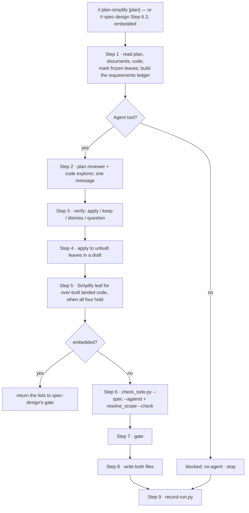

# `plan-simplify` — behaviour register

What `/r:plan-simplify` does, one claim per entry. Format and ID rules: [README.md](README.md).

It reviews a build plan written by `/r:spec-design` for over-engineering and simplifies it without
losing a requirement. It runs on its own, or embedded in `/r:spec-design` before the Codex
challenge, where the caller reads its `SKILL.md` because the `disable-model-invocation` flag
blocks the Skill tool.

## Step flow

## Entries

- **SB-plan-simplify-001** — The skill never fires on its own: `disable-model-invocation: true`.
  `/r:spec-design` reaches it by reading its `SKILL.md`.
  *States it:* `skills/plan-simplify/SKILL.md`
  *Enforced by:* `skills/plan-simplify/SKILL.md`
  *Tested by:* —

- **SB-plan-simplify-002** — A requirements ledger — stories, ADR consequences, characteristics,
  named validation, errors and security rules, the v1 line — is built before any finding is judged,
  and every cut is checked against it.
  *States it:* `skills/plan-simplify/SKILL.md`
  *Enforced by:* —
  *Tested by:* —

- **SB-plan-simplify-003** — A leaf is frozen when it carries a tick, a built marker, or a
  `.task-plans/` plan not yet `done`; a frozen leaf keeps its number, title, ticks and ticked wording.
  *States it:* `skills/plan-simplify/SKILL.md`
  *Enforced by:* `skills/spec-design/scripts/check_todo.py`
  *Tested by:* `skills/spec-design/tests/check_todo.test.sh`

- **SB-plan-simplify-004** — Findings come from two fresh read-only readers dispatched in one
  message — a plan reviewer and a code explorer. With no `Agent` tool the skill stops with
  `blocked: no-agent` rather than reviewing in its own context.
  *States it:* `skills/plan-simplify/SKILL.md`
  *Enforced by:* —
  *Tested by:* —

- **SB-plan-simplify-005** — Every finding gets one outcome — apply, keep, dismiss or question —
  and all four lists are reported. Complexity the documents demand is a question, never a cut.
  *States it:* `skills/plan-simplify/SKILL.md`
  *Enforced by:* —
  *Tested by:* —

- **SB-plan-simplify-006** — Never cut: a story or its acceptance, a named test, validation, error
  responses, auth/money/persistence/concurrency safeguards, a characteristic's verification, an ADR
  consequence, a `Done when:`, a `Resolve first` entry.
  *States it:* `skills/plan-simplify/SKILL.md`
  *Enforced by:* `skills/spec-design/scripts/check_todo.py`
  *Tested by:* —

- **SB-plan-simplify-007** — A reuse finding is applied only after the code is read and its
  semantics fit, and it is written by type or module name, never `file:LINE`.
  *States it:* `skills/plan-simplify/SKILL.md`
  *Enforced by:* —
  *Tested by:* —

- **SB-plan-simplify-008** — Over-built landed code becomes a new behaviour-preserving `Simplify`
  leaf only when the complexity is real, no ledger entry needs it, later work builds on it or it is
  a defect risk, and the landed tests keep their assertions. It is numbered after the highest frozen
  leaf and never placed in a fully built milestone.
  *States it:* `skills/plan-simplify/SKILL.md`
  *Enforced by:* —
  *Tested by:* —

- **SB-plan-simplify-009** — Standalone, the draft is checked by `check_todo.py --spec --against`
  and `resolve_scope.py --check`, shown at a gate, and both plan files are written together only
  after a yes; the report names every moved phase number.
  *States it:* `skills/plan-simplify/SKILL.md`
  *Enforced by:* `skills/spec-design/scripts/check_todo.py`
  *Tested by:* `skills/spec-design/tests/check_todo.test.sh`

- **SB-plan-simplify-010** — Standalone runs write one counts-only row, including a decline or a
  block; embedded runs write none, and the caller's row carries the counts.
  *States it:* `skills/plan-simplify/SKILL.md`
  *Enforced by:* `lib/record-run.py`
  *Tested by:* `lib/tests/stats.test.sh`

## Prose-only behaviours

002, 004, 005, 007, 008 — the review and the verification are held up by wording alone.
