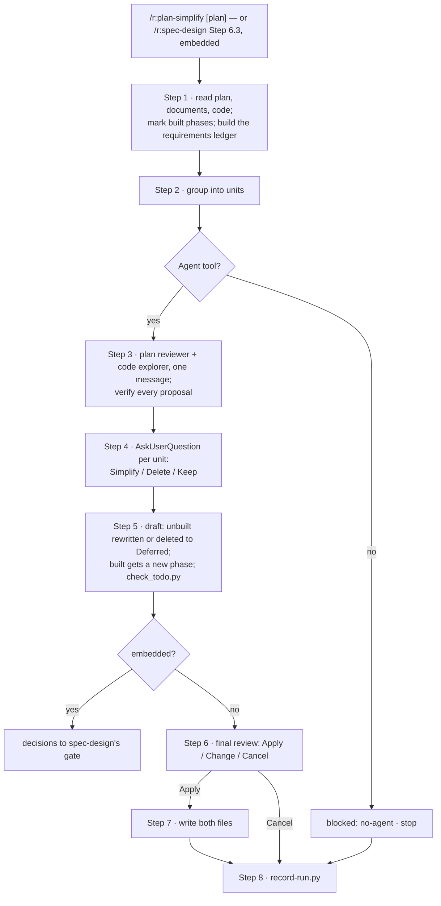

# `plan-simplify` — behaviour register

What `/r:plan-simplify` does, one claim per entry. Format and ID rules: [README.md](README.md).

It walks a phased build plan unit by unit and, for each, looks for a simpler shape or a reason the
unit is not needed. The user decides each unit, then approves the whole changed plan. It runs on its
own, or embedded in `/r:spec-design` before the Codex challenge, where the caller reads its
`SKILL.md` because the `disable-model-invocation` flag blocks the Skill tool.

## Step flow

## Entries

- **SB-plan-simplify-001** — The skill never fires on its own: `disable-model-invocation: true`.
  `/r:spec-design` reaches it by reading its `SKILL.md`.
  *States it:* `skills/plan-simplify/SKILL.md`
  *Enforced by:* `skills/plan-simplify/SKILL.md`
  *Tested by:* —

- **SB-plan-simplify-002** — A requirements ledger — stories, explicit musts, ADR consequences,
  characteristics, external systems' documented behaviour, the v1 line — is built before any unit is
  judged, and only what the plan added beyond it is open to removal.
  *States it:* `skills/plan-simplify/SKILL.md`
  *Enforced by:* —
  *Tested by:* —

- **SB-plan-simplify-003** — A phase is built when it carries a tick, a built marker, or a
  `.task-plans/` plan not yet `done`; a built phase keeps its number, title, ticks and ticked wording.
  *States it:* `skills/plan-simplify/SKILL.md`
  *Enforced by:* `skills/spec-design/scripts/check_todo.py`
  *Tested by:* `skills/spec-design/tests/check_todo.test.sh`

- **SB-plan-simplify-004** — Proposals come from two fresh read-only readers dispatched in one
  message, and are verified before anything is asked. With no `Agent` tool the skill stops with
  `blocked: no-agent` rather than reviewing in its own context.
  *States it:* `skills/plan-simplify/SKILL.md`
  *Enforced by:* —
  *Tested by:* —

- **SB-plan-simplify-005** — Every safeguard must name a trigger in this system — the ledger, an
  external system's documentation, or the code; "best practice" alone is not one.
  *States it:* `skills/plan-simplify/SKILL.md`, `skills/plan-simplify/references/rubric.md`
  *Enforced by:* —
  *Tested by:* —

- **SB-plan-simplify-006** — Each unit with a verified proposal gets one `AskUserQuestion`
  question offering Simplify, Delete or Keep, recommended first; a unit that traces to a story has no
  Delete, and what the documents themselves ask for is a question for the spec, never a removal.
  Embedded in `/r:spec-design`, clear units are decided silently and only unclear ones are asked.
  *States it:* `skills/plan-simplify/SKILL.md`
  *Enforced by:* —
  *Tested by:* —

- **SB-plan-simplify-007** — Never removed: a story's main path, a named error or validation,
  access checks, data-integrity guards, a safeguard whose trigger holds, a test of behaviour that
  stays.
  *States it:* `skills/plan-simplify/SKILL.md`
  *Enforced by:* `skills/spec-design/scripts/check_todo.py`
  *Tested by:* —

- **SB-plan-simplify-008** — An unbuilt unit is rewritten in place or deleted; each deleted phase
  becomes a plain bullet in `## Deferred` above the first milestone, never a checkbox.
  *States it:* `skills/plan-simplify/SKILL.md`
  *Enforced by:* —
  *Tested by:* —

- **SB-plan-simplify-009** — A built unit is never edited: Simplify or Delete becomes a new phase at
  the end of the plan, or just before the first unbuilt phase that builds on that code, never in a
  fully built milestone.
  *States it:* `skills/plan-simplify/SKILL.md`
  *Enforced by:* —
  *Tested by:* —

- **SB-plan-simplify-010** — Standalone, the draft is checked by `check_todo.py --spec --against`
  and `resolve_scope.py --check`, the whole change is shown, and both files are written only after
  Apply in an `AskUserQuestion`; the report names every moved phase number.
  *States it:* `skills/plan-simplify/SKILL.md`
  *Enforced by:* `skills/spec-design/scripts/check_todo.py`
  *Tested by:* `skills/spec-design/tests/check_todo.test.sh`

- **SB-plan-simplify-011** — Standalone runs write one counts-only row, including a cancel or a
  block; embedded runs write none, and the caller's row carries the counts.
  *States it:* `skills/plan-simplify/SKILL.md`
  *Enforced by:* `lib/record-run.py`
  *Tested by:* `lib/tests/stats.test.sh`

## Prose-only behaviours

002, 004, 005, 006, 008, 009 — the review, the questions and the placement are held up by wording
alone.
